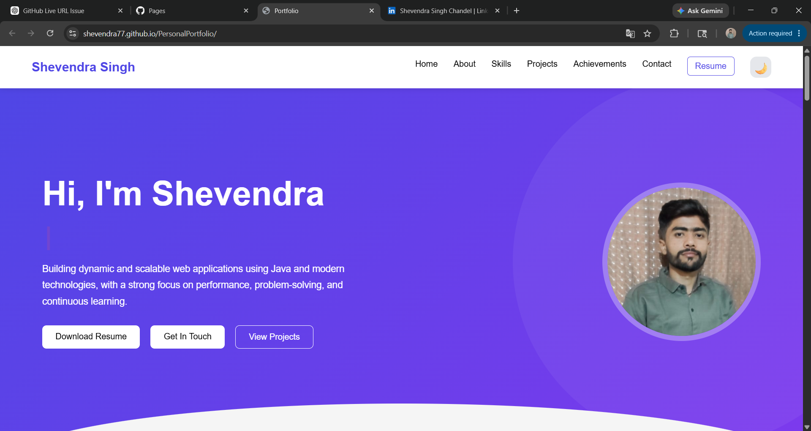
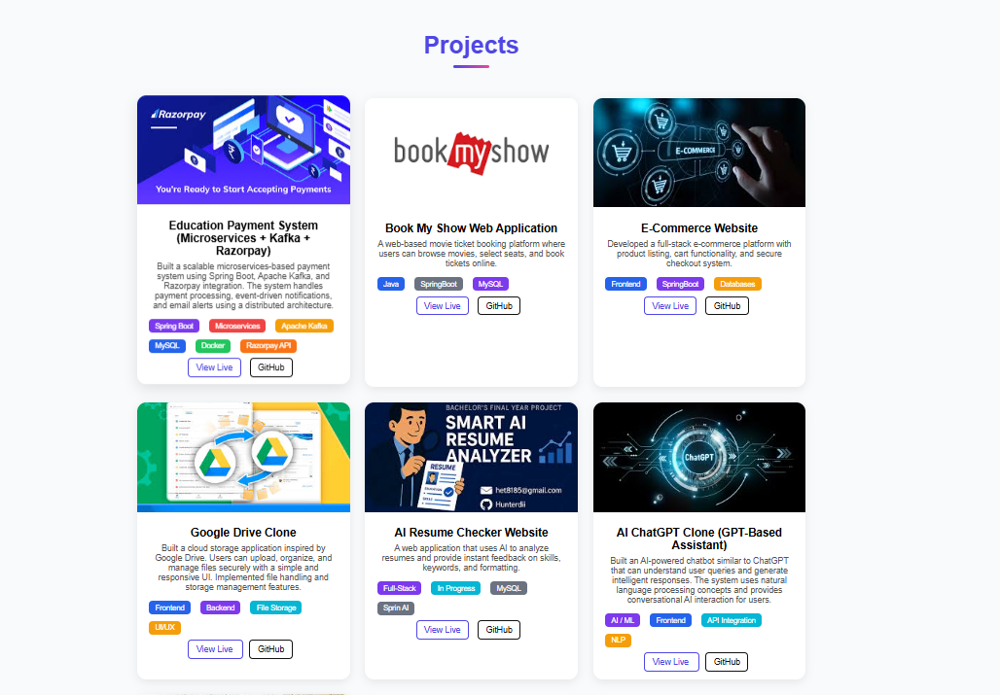

# Personal Portfolio Website

A modern, responsive, and professional portfolio website designed to showcase my skills, projects, achievements, and professional journey as a Software Developer.

## 🚀 Live Demo

🔗 **Live Portfolio:** https://shevendra77.github.io/PersonalPortfolio/

👉 [View Portfolio](https://shevendra77.github.io/PersonalPortfolio/)

---

## 📖 Overview

This portfolio website serves as a central hub for presenting my technical expertise, development projects, educational background, certifications, and contact information.

The project is designed with a focus on:
- Responsive Design
- Performance Optimization
- User Experience (UX)
- Clean UI
- Accessibility

---

## ✨ Features

- Responsive design for all devices
- Modern and clean user interface
- Project showcase section
- Skills and technologies section
- About Me section
- Contact form integration
- Social media links
- Fast loading performance
- Cross-browser compatibility

---

## 🛠️ Tech Stack

### Frontend
- HTML5
- CSS3
- JavaScript
- React.js

### Tools & Platforms
- Git
- GitHub
- VS Code

---

## 📂 Project Structure

```text
PersonalPortfolio/
│
├── public/
├── src/
│   ├── assets/
│   ├── components/
│   ├── pages/
│   ├── styles/
│   ├── App.js
│   └── index.js
│
├── package.json
├── package-lock.json
└── README.md
```

---

## ⚙️ Installation & Setup

### Clone the Repository

```bash
git clone https://github.com/Shevendra77/PersonalPortfolio.git
```

### Navigate to Project Directory

```bash
cd PersonalPortfolio
```

### Install Dependencies

```bash
npm install
```

### Run Development Server

```bash
npm start
```

### Build for Production

```bash
npm run build
```

---

## 🎯 Key Highlights

- Professional online presence
- Demonstrates Full Stack Development skills
- Showcases real-world projects
- Optimized for recruiters and hiring managers
- Mobile-first responsive design

---

## 📸 Screenshots

### Home Page


### Projects Section


### Contact Section


---

## 📈 Future Enhancements

- Dark Mode
- Blog Section
- Project Search & Filtering
- Multi-language Support
- Admin Dashboard

---

## 👨‍💻 Author

**Shevendra Chandel**

- GitHub: https://github.com/Shevendra77
- LinkedIn: YOUR_LINKEDIN_PROFILE
- Portfolio: https://shevendra77.github.io/PersonalPortfolio/

---

## 🤝 Contributing

Contributions, issues, and feature requests are welcome.

Feel free to fork this repository and submit a pull request.

---

## ⭐ Support

If you found this project helpful, please consider giving it a ⭐ on GitHub.

---

## 📄 License

This project is licensed under the MIT License.
